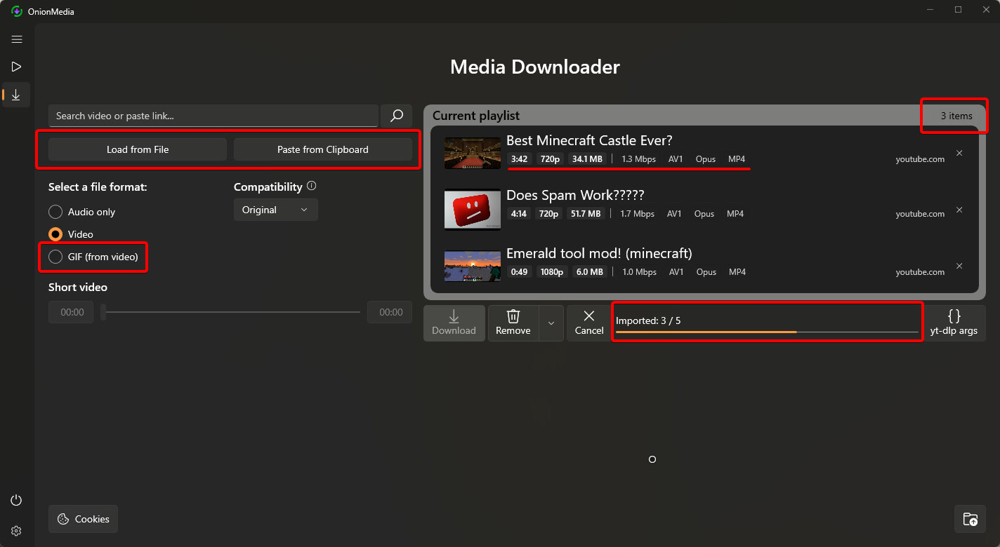
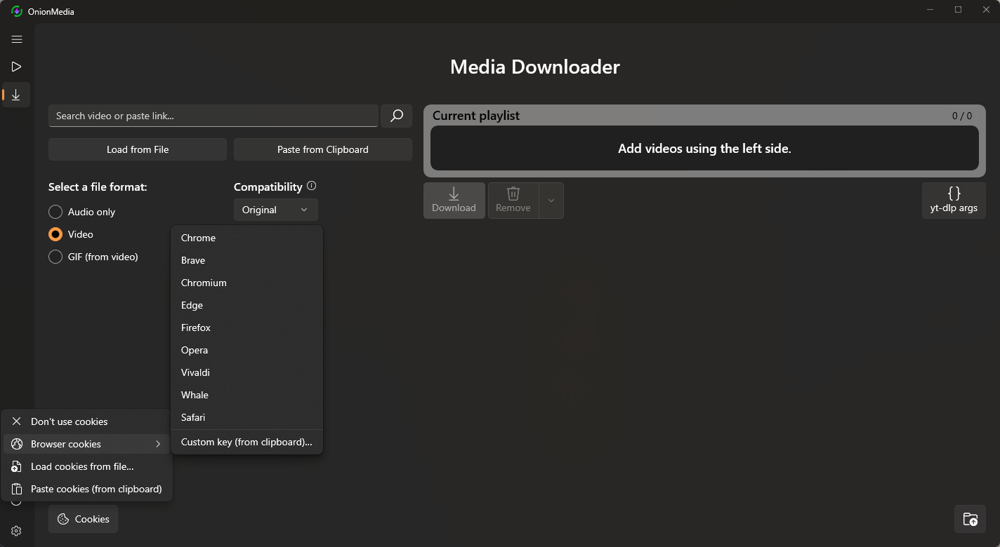
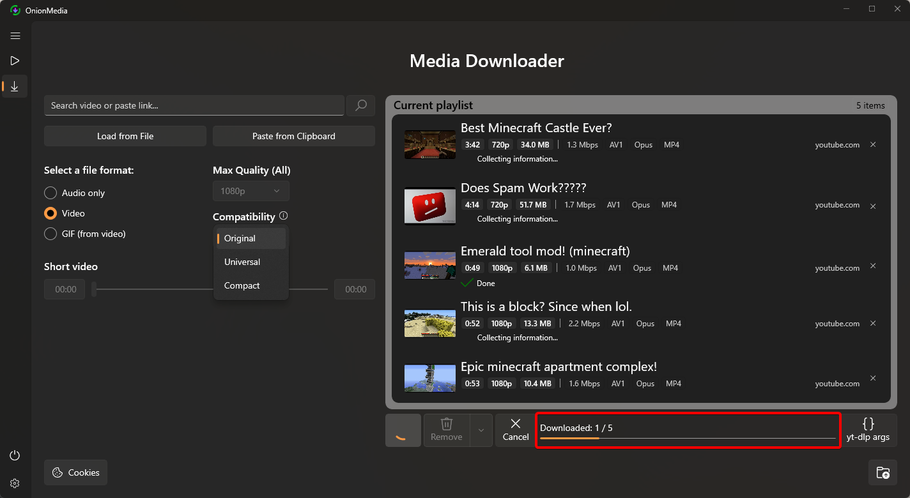
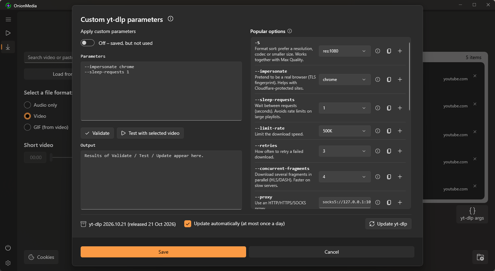

# OnionMedia Batch

> This is a fork of [OnionMedia]([https://github.com/original/project](https://github.com/onionware-github/OnionMedia))
> by Jaden [onionware-github](https://github.com/onionware-github).
> Maintained by: Kustrica.
> Licensed under AGPL-3.0.

## What’s new in this fork
- Download counter above the progress bar (`Downloaded: 3 / 12`, failed/cancelled videos in brackets) and the number of videos next to *Current playlist* (`12 items`)
- Batch download: multiple videos from a file or the clipboard
- Import progress bar with an `Imported: X / Y` counter
- GIF creation from video with selectable quality options
- Path Folder button on every page
- Removed Geo-Restrictions: Reverted YoutubeExplode to a clean version (6.0.7) to remove the political blocking message
- Full cookie support (browser, file, paste or custom key) for age-restricted and login-gated videos
- Cloudflare support: browser impersonation is switched on automatically when a site blocks yt-dlp, and the request is retried
- Video discovery on web pages: if yt-dlp finds nothing, the page itself is scanned (download buttons, players, embeds, KVS tube players) and all found qualities are offered
- Updated yt-dlp (2026.10.21) with daily auto-update (or update manually from the "yt-dlp args" window)
- **Compatibility** choice for downloaded videos: **Original** (default – saved as the site delivers it, fastest, no conversion), **Universal** (converted to H.264 + AAC in MP4 when needed, plays everywhere incl. iPhone – takes longer when converting) or **Compact** (AV1/VP9 converted to HEVC/H.265, smaller files)
- Max Quality now works as a ceiling for every site, not only YouTube
- **yt-dlp args** button for custom yt-dlp parameters with validation, a test run on the selected video and an output log (the button lights up when parameters are active, like Cookies)
- The playlist now expands when more than 3 videos are added and uses the free height of the window. Every item shows compact info in one line: duration, resolution, size | bitrate, video/audio codec, container and the site it comes from
- The info chips show the **final** file. Whatever changes is shown as *result (original)*: `1080p60 (2160p60)` when Max Quality limits the resolution, `H.264 (AV1)` / `MP4 (WEBM)` when the video is converted, `0:45 (5:40)` when *Short video* trims it. Hover a card to see the original format (*Source*)
- Max Quality always picks the best version at or below the limit (checked with real 1080p/1440p downloads of 4K videos). Some sites offer only a few versions – e.g. fap-nation has 360p/480p/720p streams plus the 4K original, so "1080p" gives 720p there; the card then shows `720p (2160p)` and the tooltip lists the available qualities
- Wider playlist: the page is split about 40/60 so the cards have more room for titles and info; buttons line up with the page margins
- Playlist editing: select several videos with **Ctrl/Shift + click**, remove them with the **Delete** key or *Remove*, remove a single video with the small **✕** on its card or *Remove from playlist* in the right-click menu (works anywhere on the card). After removing, the next video is selected instead of jumping to the end. *Short video* is hidden while several videos are selected
- Faster adding of videos: slow or dead links no longer hold up the list (shorter probe timeouts, all candidates probed in parallel, no pointless retries for unsupported/removed links)
- **Compatibility** selector next to *Max Quality* on the download page (same setting as *Settings → Video compatibility*), with a tooltip explaining the modes
- Redesigned the **yt-dlp args** window: a catalog of popular yt-dlp options with short descriptions, value pickers, *Copy* and *Add* buttons, a help button instead of long text, and a yt-dlp section with the installed version, its release date, *Update yt-dlp* and auto-update; a click outside the window closes it like *Cancel*
- Fixed the installer: the certificate restriction check ("Basic Constraints") is removed, the installer is always in English (not in the Windows language) and no longer asks to press a key – it closes by itself on success and only stays open when there is an error
- Fixed "Download thumbnail": the saved file is now a real JPG/PNG (WebP thumbnails are converted), playlist/mix links like `&list=RD...` are handled and file names are cleaned up (invisible "blank" letters, emoji, RTL marks, overlong titles – such files could not be opened by Windows Photos)
- Fixed the "Nullable object must have a value" error for videos without duration info
- Fixed videos where the site reports only the height or only the width (the missing value is estimated from the aspect ratio or measured with ffprobe, so Max Quality and the info still work)

## New Features
| Download Counter & Import Progress | Cookie Support |
|:---:|:---:|
|  |  |
| Batch Download | Custom yt-dlp Parameters |
|  |  |

## How to use the new options
- **Video compatibility** – the **Compatibility** dropdown next to *Max Quality* on the download page (or *Settings → Video compatibility*, both are the same setting).  Hover the ⓘ icon for a short explanation. **Original** (default) keeps whatever the site delivers and is the fastest. Choose **Universal** if the videos must play on any device (iPhone, TV, browser) – videos in other formats are converted, which takes longer. **Compact** gives smaller HEVC files (iPhone 7+/modern devices), converting also takes longer.
- **yt-dlp args** – the `</>` button next to *Download / Remove*. Pick an option from *Popular options* (e.g. `--impersonate chrome`, `-S vcodec:h264`, `--proxy socks5://127.0.0.1:1080`), choose a value and press *Add* (or *Copy*). Output path and `-f` are managed by OnionMedia; Max Quality is still applied. Use *Validate* and *Test with selected video* before saving. yt-dlp can be updated at the bottom of the same window.
- **Sites behind Cloudflare** – nothing to do: OnionMedia retries with browser impersonation automatically and remembers the site. Cookies (bottom-left button) can be combined with it for login-gated pages.

## Installation Guide:
1. Download the latest release (`.zip`) and extract it.
2. Open the extracted folder (e.g., `OnionMedia_xx`).
3. Double-click on `install.bat`.
4. A PowerShell window will open (always in English). Confirm the certificate installation if asked (type 'Y' / allow administrator rights). The window closes by itself after a successful installation; if something goes wrong it stays open and shows the error.
5. After successful installation you can find the app in the **Start Menu** by searching for "OnionMedia".

**Note:** You may be prompted to enable **Developer Mode** in Windows Settings. If the Settings app opens, simply toggle "Developer Mode" to **On**, then return to the PowerShell window to continue installation.

**Development Setup**

If you want to build this project from source, you need to download the required external binaries (FFmpeg and yt-dlp) first.

1.  Clone the repository.
2.  Run the `setup_dependencies.ps1` script in the root folder. You can do this by opening PowerShell in the root directory and running:

    ```powershell
    PowerShell -NoProfile -ExecutionPolicy Bypass -Command "& '.\setup_dependencies.ps1'"
    ```
3.  Open `OnionMedia.sln` in Visual Studio 2022.
4.  Build and Run.

## 
## 
# OnionMedia

You use Linux? Check out [OnionMedia X](https://github.com/onionware-github/OnionMedia-X)!

<a href="https://github.com/onionware-github/OnionMedia/blob/main/images/icon.svg">
  
</a>

Converts and downloads videos and music quickly and easily.

[Overview](#overview) • [Features](#features) • [Download](#download-and-installing) • [Releases](https://github.com/onionware-github/OnionMedia/releases) • [Discord](https://discord.gg/3ahqCzQxs8) • [Info](#info)

## Overview

You're looking for a simple solution to convert, recode, trim or even download media files and do it as easily as possible with many customizable options?

Then OnionMedia is the right choice for you.
It offers a simple and adaptive user experience and also adapts to your chosen Windows theme.
So it fits perfectly into your system as an almost native app.


Download multiple videos and audios at the same time from many platforms with just a click.
OnionMedia delivers a built-in Searchbar for Youtube, functions to recode your downloaded videos to the H.264 codec after download and lets you get shortened videos if you want.

## Features

- #### Converting files
  - Recode to other video and audio codecs.
  - Hardware-Accelerated-Encoding for video files.
  - Change resolution, aspect ratio, bitrates and frames per second.
  - Short the file and get only a part instead of the full content.
  - Edit the Tags from files (e.g. Title, Author, Album...)

- #### Downloading files
  - Supports many platforms
  - Search videos or add them directly with an URL.
  - Add multiple videos to the queue and download them at the same time.
  - Lets you select a resolution to download the video, or download only the audio of the file.
  - Recode the video after download directly to H.264

- #### Other
  - Adapts to the selected Systemtheme and Accent Color in Windows
  - Completely free and Open-Source

## Download and installing

#### Download from Microsoft Store
You can find OnionMedia in the Microsoft Store, that is preinstalled in Windows 10 and Windows 11.

<a href="https://apps.microsoft.com/detail/OnionMedia%20-%20Videodownloader%20und%20Konverter/9n252njjqb65?launch=true
    &mode=mini">
    
</a>


#### Download directly from GitHub
[Go to the Releases page and find all releases of OnionMedia to download!](https://github.com/onionware-github/OnionMedia/releases)


## Info
Copyright © Jaden Phil Nebel
###### OnionMedia is Free Software and is based on the awesome tools ffmpeg and yt-dlp for converting and downloading files.

<a href="https://ffmpeg.org/">
  
</a>


<a href="https://github.com/yt-dlp/yt-dlp">
  
</a>
<br/><br/><br/>
Looking for a reliable video downloader on Android? Check out <a href="https://github.com/JunkFood02/Seal">Seal</a> from <a href="https://github.com/JunkFood02">JunkFood02</a>!

## More information
You still have open questions? [Join our Discord Server](https://discord.gg/3ahqCzQxs8)
